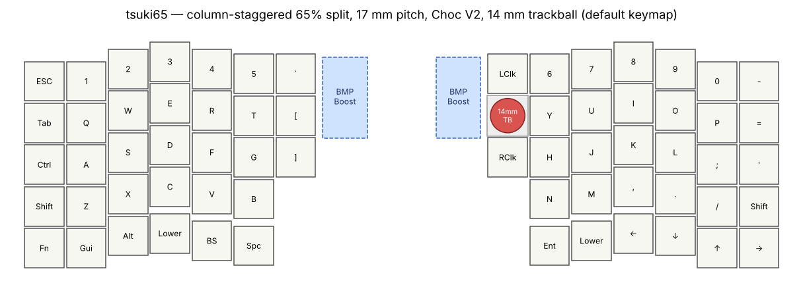
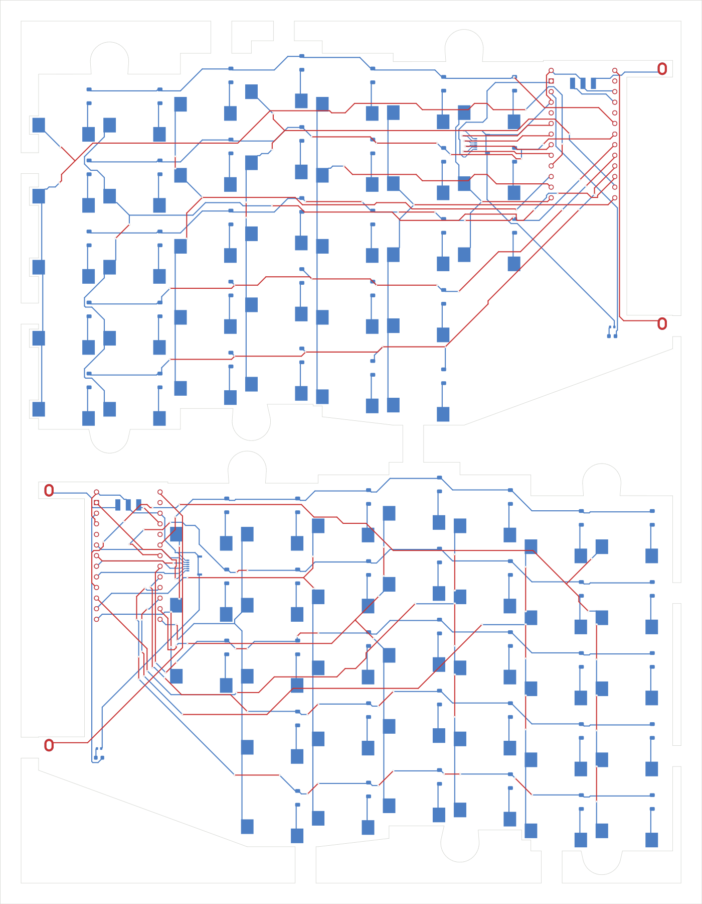
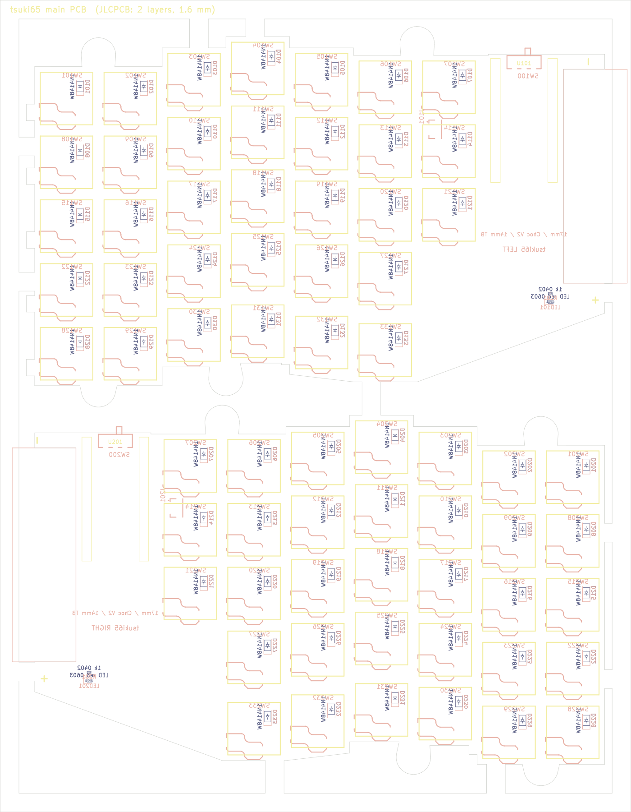
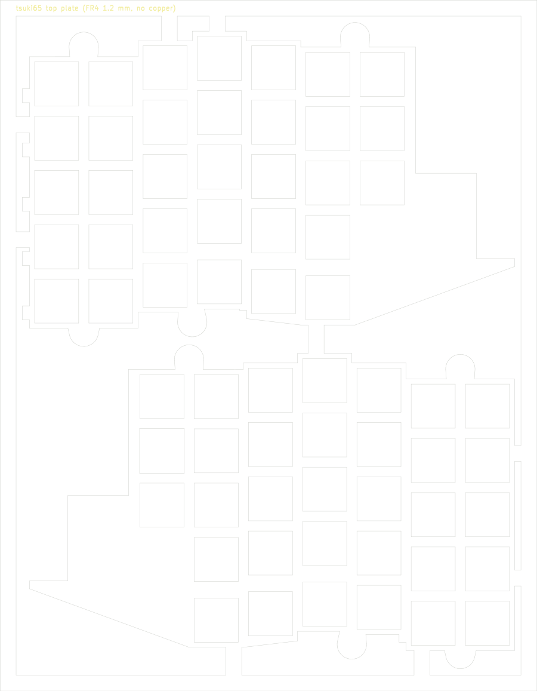
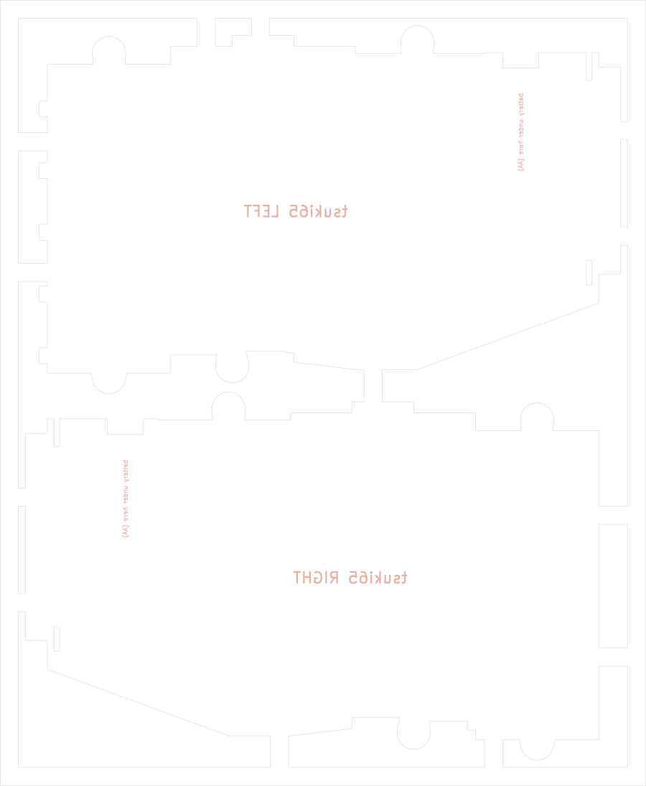

# tsuki65

[torabo-tsuki LP](https://github.com/sekigon-gonnoc/torabo-tsuki-lp)（Mサイズ）をベースにした、自分用の
**カラムスタッガード 65% 分割キーボード + 14mm トラックボール** です。



| 項目 | 仕様 |
| --- | --- |
| 形状 | 左右分割、カラムスタッガード（列オフセット 8/8/3/0/3/5/5 mm） |
| キー数 | 65 キー + 14mm トラックボール（マトリクス上は 66 ポジション。右 r1/c6 がトラックボール位置） |
| キーピッチ | **17 mm × 17 mm** |
| スイッチ | Kailh Choc V2（ホットスワップソケット CPG135001S30） |
| トラックボール | 14 mm、[maghold-trackball-case 14mm_17x17](https://github.com/shizu0428/maghold-trackball-case/tree/main/14mm-case_17x17) を **右手 r1/c6 のスイッチ穴（14×14 mm）に装着** |
| センサー | のぎけす屋 14mm マウスセンサーモジュール（PAW3222）、0.5 mm ピッチ 6P FPC |
| コントローラ | BMP Boost ×2（ピンアサインは torabo-tsuki LP と同一） |
| 電源 | 単三電池 ×1 / 片手（Ni-MH 可）、スライドスイッチ |
| ファームウェア | ZMK（右手 = セントラル、左手 = ペリフェラル） |
| 基板サイズ | 片手 約 154 × 101 mm（ボトムプレートは電池部分 +6 mm） |
| 構成 | メイン基板(1.6mm) / トッププレート(FR4 1.2mm) / ボトムプレート(FR4 1.6mm) / M2 4.5mm スペーサー |

torabo-tsuki LP M から引き継いでいるもの:

* BMP Boost・電池ボックス・電源スイッチ周り（**コントローラブロック**）の位置関係をそのまま移植しているので、
  torabo-tsuki LP の電池カバー `controller-cover-aa-Body(.stl / -mirror.stl)` がそのまま使えます（`3d/` に同梱）。
* マトリクス（ROW0-4 / COL0-6、row2col）と BMP Boost のピンアサイン、FPC コネクタの配線。
  → torabo-tsuki LP の ZMK 設定をほぼそのまま流用（`firmware/`）。
* プレート間を M2 × 4.5mm スペーサーで挟む積層構造（メイン基板には 5mm 穴）。

---

## ディレクトリ

```
keyboard/tsuki65/
├── fab/                      ← JLCPCB にそのままアップロードするファイル
│   ├── main/tsuki65-main-gerbers.zip       メイン基板（左右 + 外枠をマウスバイトで面付け）
│   ├── main/tsuki65-main-bom.csv           JLCPCB PCBA 用 BOM（LCSC 品番入り）
│   ├── main/tsuki65-main-cpl.csv           JLCPCB PCBA 用 部品配置ファイル（全部品 Bottom 面）
│   ├── top-plate/tsuki65-top-plate-gerbers.zip
│   └── bottom-plate/tsuki65-bottom-plate-gerbers.zip
├── pcb/                      ← KiCad 7 で開けるボードデータ（.kicad_pcb）とフットプリント
├── 3d/                       ← 電池カバー STL（torabo-tsuki LP より, MIT）
├── firmware/                 ← ZMK モジュール（そのまま zmk-config リポジトリとして使える）
├── img/                      ← プレビュー画像
└── scripts/                  ← 設計を全部生成するスクリプト（レイアウト変更→再生成できる）
```

| メイン基板（配線） | メイン基板（部品・裏面） |
| --- | --- |
|  |  |
| **トッププレート** | **ボトムプレート** |
|  |  |

---

## 1. JLCPCB に発注する

### 1-1. メイン基板（PCBA あり）

1. <https://cart.jlcpcb.com/quote> で `fab/main/tsuki65-main-gerbers.zip` をアップロード。
2. 基板設定
   * Base Material: FR-4 / Layers: **2** / PCB Thickness: **1.6 mm**
   * Dimensions: 自動（約 168 × 216 mm）
   * Different Design: **1**（左右と外枠はマウスバイトでつながった 1 枚のデータです。JLC から問い合わせが来たら「1 design (panel with mouse bites), please produce as is」と回答）
   * Mark on PCB（注文番号）: 「Remove Mark」推奨（無料オプションが無い場合は Order Number で可）
3. **PCB Assembly** をオン
   * PCBA Type: Economic / **Assembly Side: Bottom Side** / PCBA Qty: 2 以上
4. `fab/main/tsuki65-main-bom.csv` と `fab/main/tsuki65-main-cpl.csv` をアップロード。
5. 部品確認画面で以下を確認

   | 部品 | 数 | LCSC | 備考 |
   | --- | --- | --- | --- |
   | Kailh CPG135001S30（Choc ホットスワップソケット） | 66 | C5333465 | 在庫切れの場合は JLC 部品検索で `CPG135001S30` を探して差し替え。無ければ手はんだ（フットプリントは手はんだ用の大きめパッド） |
   | 1N4148W（SOD-123） | 66 | C81598 | Basic part |
   | GT-F0501SR10-06S1101（0.5mm 6P FPC コネクタ） | 2 | C22380676 | トラックボールセンサー用 |
   | K3-1280S-F1（スライドスイッチ） | 2 | C92658 | 電源スイッチ |
   | LED 0603 赤 | 2 | C2286 | 状態 LED |
   | 抵抗 1kΩ 0402 | 2 | C11702 | LED 用 |

6. **部品配置プレビューで向きを必ず確認**。特にダイオードの向き（カソード側＝ソケットの近い側／南側）、
   ソケット、FPC コネクタ、スライドスイッチ。ずれていたら JLC の画面で回転を修正します。

### 1-2. トッププレート

* `fab/top-plate/tsuki65-top-plate-gerbers.zip`、Layers: 2、**PCB Thickness: 1.2 mm**（Choc のプレート厚）
* 銅箔はありません。色はお好みで。スイッチ穴 13.8 mm 角、トラックボール位置（右 r1/c6）は 14.0 mm 角。

### 1-3. ボトムプレート

* `fab/bottom-plate/tsuki65-bottom-plate-gerbers.zip`、Layers: 2、**PCB Thickness: 1.6 mm**
* 電池ボックスのピンを通すスリットと、電源スイッチ操作用の切り欠きがあります。

### 1-4. 3D プリント（JLC3DP など）

| 部品 | データ | 数 |
| --- | --- | --- |
| 電池カバー 左 | `3d/controller-cover-left.stl`（torabo-tsuki LP `controller-cover-aa-Body.stl`） | 1 |
| 電池カバー 右 | `3d/controller-cover-right.stl`（同 `-mirror.stl`） | 1 |
| 14mm トラックボールケース | [shizu0428/maghold-trackball-case `14mm-case_17x17/14mm_maghold-TBcase_v1.stl`](https://github.com/shizu0428/maghold-trackball-case/tree/main/14mm-case_17x17)（CC BY-NC 4.0、個人利用可・同梱していません） | 1 |

JLC3DP の手順は [torabo-tsuki LP ビルドガイド](https://github.com/sekigon-gonnoc/torabo-tsuki-lp/blob/main/build-guide.md#3dプリント部品の製造jlc3dp利用) と同じです。

## 2. 別途購入する部品

| 部品 | 数 | 備考 |
| --- | --- | --- |
| BMP Boost | 2 | BOOTH / 遊舎工房。BLE Micro Pro（無印）は不可 |
| コンスルー 13 ピン（高さ 2.5mm） | 4 | |
| 単三電池ボックス（1 本用・基板取付ピン付き） | 2 | ピン間 **61 mm**（torabo-tsuki LP V1 と同じ）。合うものが無い場合はリード線付きボックスの線をパッドにはんだ付けしても可 |
| 単三電池 | 2 | Ni-MH 推奨 |
| Kailh Choc V2 スイッチ | 65 | （トラックボールを付けない左手 r1/c6 も含む） |
| キーキャップ | 65 | **17 mm ピッチなので 16.5 mm 角以下** のロープロ用（Choc V2 は MX 互換ステム）。一般的な 17.5×16.5 mm の Choc キャップは横方向で干渉します |
| 14mm トラックボール（磁性あり） | 1 | maghold ケースの README 参照 |
| 14mm マウスセンサーモジュール | 1 | のぎけす屋 BOOTH |
| ベアリング 4×1.5×2 mm、M1.4 ねじ ×3、磁石 5×10×1 mm ×1 | 1 式 | maghold ケース用 |
| FFC 0.5mm ピッチ 6P（電極同一面）30〜50 mm 程度 | 1 | センサー⇔基板 |
| M2 スペーサー 4.5 mm | 14 | 片手 7 本 |
| M2 × 3.5 mm ねじ | 28 + 2 | +2 は電池カバー固定用（torabo と同じ穴位置） |
| ゴム足 | 8 | 薄型 |

## 3. 組み立て

1. メイン基板・プレートのマウスバイト（タブ）を折って外枠を外し、やすりで整える。
2. ボトムプレートの下に電池ボックスを置き、ピンをスリットに通してメイン基板の電池パッドにはんだ付け
   （**+ 極が手前側（下側）、− 極が BMP Boost の USB 側（奥側）**。torabo-tsuki LP と同じ向き。基板裏のシルク `+` も確認）。
3. コンスルーを差して BMP Boost を載せる（部品面が上）。
4. トッププレートにスイッチをはめ、メイン基板のホットスワップソケットに差し込む。
5. トップ⇔ボトムを M2 × 4.5mm スペーサーで固定（メイン基板の 5mm 穴をスペーサーが貫通）。
6. トラックボール（右手）
   * maghold ケースを組み立て（磁石・ベアリング・センサー）。
   * FFC をケースのセンサーに挿し、**トッププレートの 14mm 穴 → メイン基板のスイッチ中央穴** を通して、
     基板裏の FPC コネクタ（J201、穴のすぐ左上）へ挿す。ケースを 14 mm 穴に差し込む。
7. 電池カバーをかぶせて M2 ねじで固定。

## 4. ファームウェア（ZMK）

`firmware/` は単体の zmk-config リポジトリになっています。

1. GitHub に新しいリポジトリ（例: `zmk-config-tsuki65`）を作り、`firmware/` の **中身** をルートに置いて push。
2. Actions が自動でビルド → Artifacts から以下をダウンロード
   * `tsuki65_right_central.uf2` … 右手（トラックボール側、PC と接続）
   * `tsuki65_left_peripheral.uf2` … 左手
   * `settings_reset.uf2` … ペアリングをやり直すとき
3. BMP Boost をブートローダーモードにして uf2 を書き込む（手順は torabo-tsuki LP ビルドガイドと同じ）。
4. キーマップは `firmware/config/tsuki65.keymap`、または ZMK Studio（USB 接続）で変更。

トラックボールの向きが逆・90° ずれている場合は `firmware/boards/shields/tsuki65/tsuki65_right.overlay` の
`INPUT_TRANSFORM_*` を変更してください（maghold ケース内のセンサー向きに依存）。

## 5. 設計を変更する

レイアウトは `scripts/layout.py` に集約しています（ピッチ・列オフセット・トラックボール位置・スペーサー位置など）。

```sh
# Ubuntu 24.04: apt install kicad python3-shapely python3-matplotlib ; pip install cairosvg
cd keyboard/tsuki65/scripts
./build_all.sh      # 部品配置 → 自動配線 → プレート → DRC → ガーバー/BOM/CPL → ZMK → 画像
```

* `gen_main.py`  メイン基板（フットプリント配置・ネット・外形・面付け）
* `route.py`     自作の 2 層グリッド自動配線（A* + リップアップ）
* `gen_plates.py` トップ/ボトムプレート
* `drc.py`       KiCad DRC（電気的エラー/未接続 0 でなければ失敗）
* `export_fab.py` JLCPCB 用出力
* `gen_fw.py`    ZMK のマトリクス変換・物理レイアウト・キーマップ
* 回路図（.kicad_sch）は作っていません。ネットは `gen_main.py` 内で定義しています（torabo-tsuki LP と同じ回路）。

### 回路（片手分）

* キー: ROW → ダイオード(A→K) → ソケット → COL（ZMK `row2col`）
* BMP Boost: 1 GND, 2 VCC, 3 LED, 6 SCLK, 7 SDIO, 8 MOTION, 9 CS, 10 COL0, 11 COL2, 12 COL4, 13 COL6, 14 COL5,
  15 COL3, 16 COL1, 17 ROW4, 18 ROW3, 19 ROW2, 20 ROW1, 21 ROW0, 23 BOOT, 24 GND, 26 +BATT
* FPC: 1 GND, 2 SCLK, 3 SDIO, 4 MOTION, 5 CS, 6 VCC
* 電源スイッチ: BAT− ⇔ GND（ON）/ BOOT
* COL0 = 外側（小指側）… COL6 = 内側。右手は物理的に鏡像、マトリクス列は ZMK で +7 オフセット。

## 6. 検証状況と注意点

**試作はしていません。** 以下は確認済み/未確認です。

確認済み

* KiCad 7 DRC: メイン基板・両プレートとも配線/クリアランス/穴/外形エラー 0、未接続 0
  （残りはシルクとライブラリリンクの警告のみ）。配線幅 0.25 mm、クリアランス 0.2 mm、ビア 0.6/0.3 mm（JLC 標準仕様内）。
* torabo-tsuki LP と同じフットプリント・ピンアサイン・コントローラブロック寸法。

未確認（発注前・組立時に確認してください）

* JLC の部品在庫（特に Choc ソケット C5333465）と、CPL の回転（裏面実装のため JLC プレビューで要確認）。
* FPC コネクタの差込方向とケーブル長（コネクタは接点側が西＝列間を向いています）。
* 電池ボックスの寸法（ピン間 61 mm 前提）。
* maghold 14mm ケースと隣接キーキャップのクリアランス（17mm ピッチ用ケースなので問題ない想定）。
* ZMK ファームウェアはこの環境ではビルドしていません（torabo-tsuki LP の構成をベースにしています）。
* 17 mm ピッチではスイッチ間に 5 mm 穴を開ける余地がないため、スペーサーはスタッガードの段差部分や
  空きスペース（片手 7 か所）に置き、外形に小さな耳を付けています。

## クレジット / ライセンス

* 基板フットプリント・電池カバー STL・コントローラブロック寸法:
  [torabo-tsuki LP](https://github.com/sekigon-gonnoc/torabo-tsuki-lp) © sekigon-gonnoc, MIT License（`pcb/LICENSE-torabo-tsuki-lp`）
* ZMK 設定: [zmk-keyboard-torabo-tsuki-lp](https://github.com/sekigon-gonnoc/zmk-keyboard-torabo-tsuki-lp) ベース, GPL-3.0（`firmware/LICENSE`）
* 14mm トラックボールケース: [maghold-trackball-case](https://github.com/shizu0428/maghold-trackball-case) © shizu0428, CC BY-NC 4.0（同梱なし・リンクのみ）
